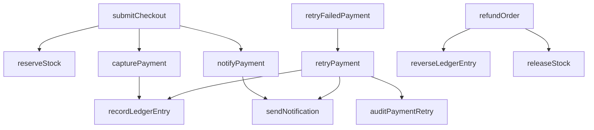

# Ledger Lane

A small stationery shop used to demonstrate [ChangeGraph](https://github.com/Jatan88/ChangeGraph). The counter is a React page. The bookkeeping is an in-memory Express API. There is no database.

Publish this folder as its own public GitHub repository before linking it in ChangeGraph. ChangeGraph ingests a whole repository and stops at 40 source files, so this app stays separate from the ChangeGraph repo.

## Run

```bash
npm install
npm test
npm run dev
```

The shop is at http://localhost:5174. The API is at http://localhost:3040. Vite proxies `/api` to the API.

`npm test` runs the server tests. `npm run typecheck` checks the TypeScript.

## Shop demo

1. Take an item to the counter.
2. Enter card `0000` and place the order. The card is declined, no ledger line is written, and the stock stays reserved for that order.
3. On the receipt, choose **Retry payment**. One retry line is posted and the order is marked paid.
4. Choose **Retry again**. The same ledger line comes back. A second retry does not write another entry.
5. Choose **Refund order**. The stock returns and a reversal line is posted.

Any other four digits are captured on the first try.

## ChangeGraph demo

The server is written so ChangeGraph can follow it. Each function name appears once. Each call passes as many arguments as that function declares. Service classes use `@Injectable()` or `@Controller()`. The service methods do not call library helpers, so those calls are not left unresolved. Tests call `submitCheckout`, `capturePayment`, `recordLedgerEntry`, `notifyPayment`, and `sendNotification`. No test calls `retryPayment`.



The seeded retry incident links to `retryPayment`. The notification example is stored and stays unlinked, because those functions are not in a payment file.

The demos run on `main`. The retry scene removes the retry guard. The stock scene removes the shelf check. The refund scene removes the zero-reversal guard. The receipt scene removes the missing-order guard. The steps are in [walkthrough/DEMO.md](walkthrough/DEMO.md). The words for the retry scene are in [walkthrough/SCRIPT.md](walkthrough/SCRIPT.md).
