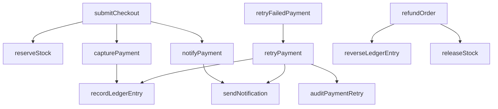

# Ledger Lane

A small stationery shop used to demonstrate [ChangeGraph](https://github.com/Jatan88/ChangeGraph). The counter is a React page. The bookkeeping is an in-memory Express API. There is no database.

Publish this folder as its own public GitHub repository before linking it in ChangeGraph. ChangeGraph ingests a whole repository and stops at 40 source files, so this app stays separate from the ChangeGraph repo.

## Run

```bash
npm install
npm test
npm run dev
```

The shop is at http://localhost:5174. The API is at http://localhost:3040. Vite proxies `/api` to the API.

`npm test` runs the server tests. `npm run typecheck` checks the TypeScript.

## Shop demo

1. Take an item to the counter.
2. Enter card `0000` and place the order. The card is declined, no ledger line is written, and the stock stays reserved for that order.
3. On the receipt, choose **Retry payment**. One retry line is posted and the order is marked paid.
4. Choose **Retry again**. The same ledger line comes back. A second retry does not write another entry.
5. Choose **Refund order**. The stock returns and a reversal line is posted.

Any other four digits are captured on the first try.

## ChangeGraph demo

The server is written so ChangeGraph can follow it. Each function name appears once. Each call passes as many arguments as that function declares. Service classes use `@Injectable()` or `@Controller()`. The service methods do not call library helpers, so those calls are not left unresolved. Tests call `submitCheckout`, `capturePayment`, `recordLedgerEntry`, `notifyPayment`, and `sendNotification`. No test calls `retryPayment`.



Synthetic payment incidents attach to `retryPayment`, `recordLedgerEntry`, `sendNotification`, and `notifyPayment`.

1. In ChangeGraph, create a project and link the public repository URL for this folder.
2. Select the default branch and ingest it.
3. Seed the synthetic payment incidents.
4. From this directory, apply the risky edit and commit it:

```bash
patch -p1 < walkthrough/drop-idempotency.patch
```

That removes the idempotency guard inside `retryPayment` and adds `warnDuplicateLedger` on a new `RetryWarningService`. The next retry writes another ledger line and records an unguarded-retry warning. The guard sits in the body of `retryPayment`, so the commit diff does not also mark `capturePayment` changed. No test calls `retryPayment` or `warnDuplicateLedger`.

5. Commit and push that edit on the selected branch.

ChangeGraph detects the push and reviews the graph. The report should show `retryPayment` as modified and `warnDuplicateLedger` as added. `retryFailedPayment` calls `retryPayment`. Downstream of the retry are `recordLedgerEntry`, `warnDuplicateLedger`, `sendNotification`, and `auditPaymentRetry`, on other annotated services. Neither changed function has a direct test. Those findings are actionable. The Developer Agent opens a `changegraph/fix-*` pull request that puts the guard back and adds a test calling the changed function. The pull request is for a person to review. It is not merged, and it is not pushed to the default branch.
